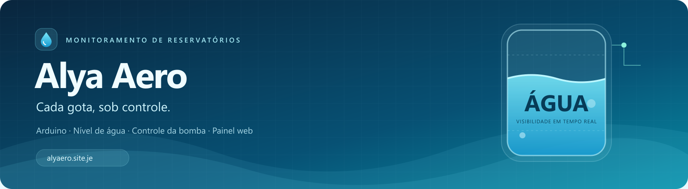
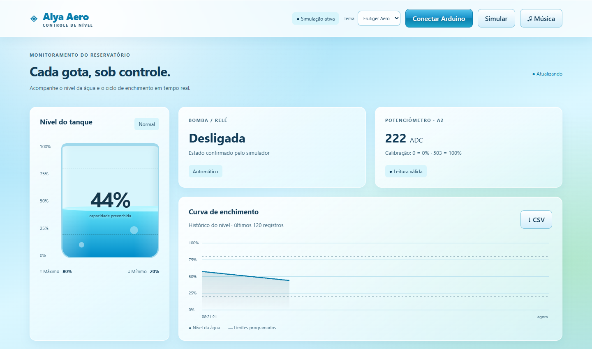
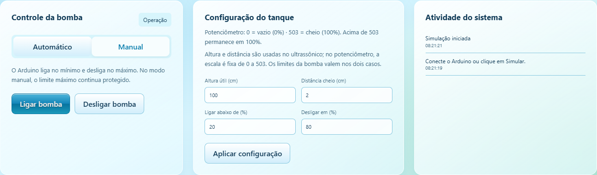
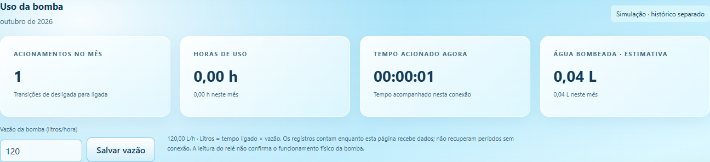
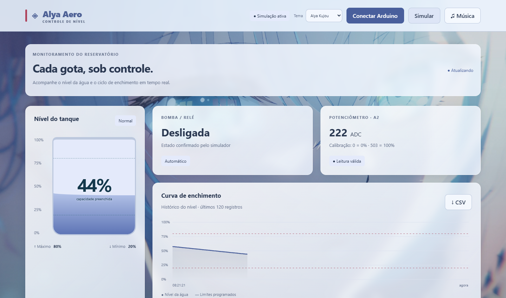
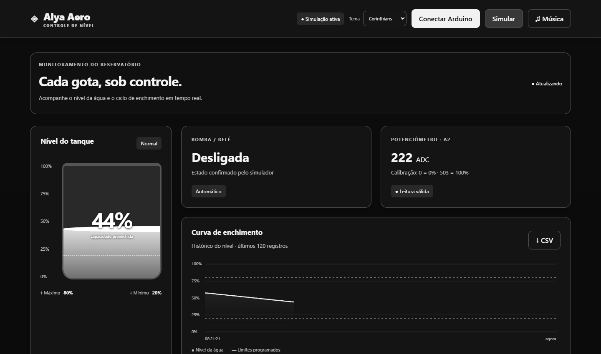
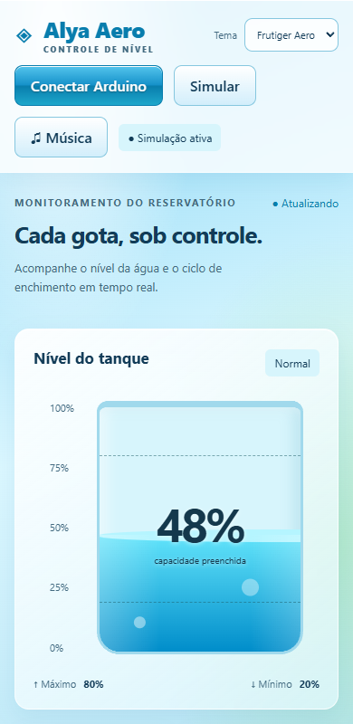
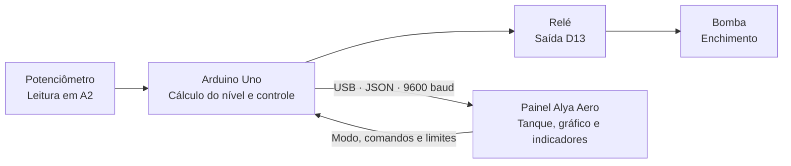

<div align="center">



### Seu reservatório, acompanhado em tempo real.

Um sistema para visualizar o nível da água, controlar a bomba e acompanhar seu uso com Arduino.

[](https://alyaero.site.je)


[Conheça o projeto](#-sobre-o-projeto) · [Veja as telas](#-o-projeto-em-telas) · [Como usar](#-como-usar) · [Montagem](#-arduino-e-montagem)

</div>

## 💧 Sobre o projeto

O **Alya Aero** reúne o monitoramento de um reservatório em uma interface visual: o tanque acompanha o nível informado pelo Arduino, o gráfico registra as leituras e os controles permitem alternar entre operação automática e manual.

A proposta é acompanhar o enchimento com clareza: **quanto há no tanque, quando a bomba liga e por quanto tempo ela permanece acionada**. O visual tem inspiração Frutiger Aero, com água animada, transparências e temas personalizáveis.

> **Experimente sem montar o circuito:** abra [alyaero.site.je](https://alyaero.site.je) e clique em **Simular**.

## ✨ Recursos

| Recurso | O que você acompanha |
|---|---|
| **Tanque visual** | Percentual de preenchimento e indicação de nível baixo, normal ou máximo. |
| **Leitura do sensor** | Valor ADC do potenciômetro ou distância na versão com ultrassônico. |
| **Controle automático** | Acionamento no limite mínimo e desligamento no limite máximo. |
| **Controle manual** | Botões para ligar e desligar a bomba, mantendo a proteção do nível máximo. |
| **Curva de enchimento** | Histórico das últimas 120 amostras da sessão e exportação em CSV. |
| **Indicadores de uso** | Acionamentos no mês, horas observadas e duração do acionamento atual. |
| **Água bombeada** | Estimativa em litros calculada a partir do tempo ligado e da vazão configurada. |
| **Modo de simulação** | Demonstração do painel sem precisar conectar o Arduino. |
| **Personalização** | Nove temas, preferência salva no navegador e player Spotify integrado. |

## 📸 O projeto em telas

As capturas abaixo são do **site publicado**, feitas em **30/10/2026**, com o **modo de simulação** ativo. Os valores exibidos são demonstrativos.

### Painel principal · Frutiger Aero



### Controle, configuração e atividade



### Indicadores de uso da bomba



### Temas para deixar o painel com a sua cara

| Alya Kujou | Corinthians |
|:---:|:---:|
|  |  |

Também estão disponíveis **Frutiger Aero, Vermelho, Roxo, Rosa, Amarelo, Claro e Escuro**.

<details>
<summary><strong>📱 Ver a interface em uma tela menor</strong></summary>

<br />
<p align="center">
  
</p>

A interface se adapta a telas menores. Para conectar o Arduino pela USB, utilize Chrome ou Edge no computador.

</details>

## ⚙️ Como funciona



O **Arduino executa o controle da bomba**. O navegador apresenta os dados e envia comandos; o ciclo automático não depende de manter o site aberto.

### Calibração: 0 a 503

Na montagem com potenciômetro, a escala foi ajustada para:

| Leitura ADC | Nível apresentado |
|:---:|:---:|
| `0` | **0% — vazio** |
| `251` ou `252` | **Aproximadamente 50%** |
| `503` | **100% — cheio** |
| Acima de `503` | **100% — limitado ao máximo** |

```text
nível (%) = limitar((leitura ADC × 100) / 503, 0, 100)
```

O cálculo deve estar atualizado **tanto no painel quanto no firmware**, para a exibição e o controle da bomba usarem a mesma escala. Na montagem atual, **503 é uma leitura analógica; não é uma distância em centímetros**.

### Ciclo automático

- **Até 20%:** a bomba liga.
- **A partir de 80%:** a bomba desliga.
- **Entre os limites:** mantém o estado anterior, evitando alternâncias a cada pequena variação.

Esses são os valores padrão; os limites podem ser alterados no painel. No modo manual, o limite máximo continua desligando a bomba. O comando **Desligar bomba** também muda a operação para Manual.

## 🚀 Como usar

### 1. Experimentar no navegador

1. Acesse **[alyaero.site.je](https://alyaero.site.je)**.
2. Clique em **Simular**.
3. Acompanhe o tanque e o gráfico.
4. Alterne entre **Automático** e **Manual**, experimente os controles e escolha um tema.

### 2. Conectar o Arduino

1. Abra `arduino_potenciometro/arduino_potenciometro.ino` na **IDE Arduino**.
2. Selecione a placa **Arduino Uno**, confira a porta e envie o sketch.
3. Feche o Monitor Serial da IDE para liberar a porta.
4. Abra o site em **Chrome ou Edge no computador**.
5. Selecione **9600 baud**, clique em **Conectar Arduino** e escolha a porta da placa.
6. Aguarde a primeira leitura e confira os limites antes de operar a bomba.

> A conexão USB utiliza **Web Serial** e precisa de **HTTPS** ou `localhost`. O Arduino deve estar conectado ao computador que abriu o painel; a hospedagem do site não cria uma conexão remota com a placa pela internet.

### 3. Rodar o site localmente

Na pasta que contém `index.html`, execute:

```bash
python -m http.server 8000 --bind 127.0.0.1
```

Depois, abra **http://localhost:8000**. A interface usa HTML, CSS e JavaScript, sem etapa de build ou instalação de pacotes para funcionar.

## 🔌 Arduino e montagem

A montagem atual utiliza **Arduino Uno, potenciômetro de 10 kΩ e módulo relé**.

| Componente / conexão | Pino do Uno |
|---|---|
| Potenciômetro · terminal central | `A2` |
| Potenciômetro · externo positivo, na montagem de teste | `A0` em HIGH |
| Potenciômetro · externo negativo, na montagem de teste | `A4` em LOW |
| Relé · sinal de controle, ativo em LOW | `D13` |
| Bluetooth · TXD do módulo, se utilizado | `D3` — RX do Arduino |
| Bluetooth · RXD do módulo, se utilizado | `D4` — TX do Arduino, com divisor de tensão |

O firmware ajustado mantém a comunicação USB e Bluetooth a **9600 baud**, com `SoftwareSerial(3, 4)` para o módulo. **A interface web publicada utiliza a conexão USB.**

`D13` também é o LED integrado: uma segunda escrita nesse LED pode interferir no relé. `A0` e `A4` são GPIO usados na montagem de teste; a bomba e o módulo Bluetooth precisam de alimentação adequada, e a bomba não deve ser alimentada por um pino do Arduino.

<details>
<summary><strong>Versão alternativa com sensor ultrassônico</strong></summary>

O projeto também possui o sketch `arduino/arduino.ino` para **HC-SR04**, com **TRIG em D9**, **ECHO em D10**, **relé em D7** e comunicação a **115200 baud**.

Nessa versão, configure a altura útil do tanque e a distância do sensor até a água quando cheio. A porcentagem é calculada pela distância medida. Essa pinagem e essa velocidade pertencem à versão ultrassônica; utilize o sketch correspondente à sua montagem.

</details>

## 📊 O que os contadores significam

Os litros exibidos são uma **estimativa de água bombeada**:

```text
litros estimados = tempo observado com a bomba ligada (horas) × vazão (L/h)

Exemplo: 0,5 hora × 120 L/h = 60 litros
```

- A vazão padrão é **120 L/h**, ajustável no painel.
- Os registros ficam no armazenamento local do navegador, separados entre **Arduino** e **simulação**.
- A contagem depende de a página estar aberta e recebendo dados; períodos desconectados não são recuperados.
- Após **5 segundos sem dados**, o painel sinaliza a ausência de leitura, bloqueia o acionamento manual e suspende a contagem.
- Alterar a vazão afeta os próximos intervalos; os litros anteriores não são recalculados.

O estado do relé não confirma fisicamente o funcionamento do motor. A estimativa de litros não substitui um sensor de vazão nem mede o consumo na saída do reservatório.

## 🛠️ Tecnologias

| Camada | Tecnologias |
|---|---|
| Interface | HTML5, CSS3 e JavaScript |
| Gráfico | Canvas 2D |
| Comunicação com a placa | Web Serial e mensagens JSON |
| Controle embarcado | Arduino / C++ e SoftwareSerial |
| Preferências e histórico de uso | Armazenamento local do navegador |
| Música | Player incorporado do Spotify |
| Hospedagem | InfinityFree |

## 📁 Arquivos principais

```text
index.html                 # Estrutura do painel
style.css                  # Layout e estilos
app.js                     # Conexão USB, comandos, gráfico e simulação
sensor.js                  # Calibração do potenciômetro: 0–503
theme.js                   # Temas da interface
usage.js                   # Indicadores de uso e estimativa de litros
media.js                   # Controles do player de música
assets/                    # Imagens usadas pelos temas
arduino_potenciometro/      # Firmware da montagem atual
arduino/                    # Firmware alternativo para HC-SR04
docs/images/               # Banner e capturas deste README
README.md                  # Apresentação e guia do projeto
```

---

<div align="center">

**Alya Aero** · Cada gota, sob controle.

[Abrir o painel](https://alyaero.site.je) · [Voltar ao início](#)

</div>
